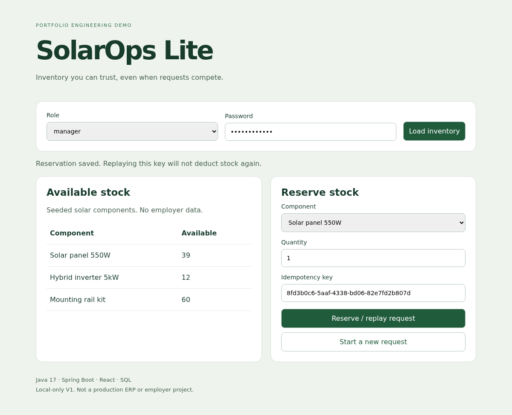

# SolarOps Lite

A focused solar-component inventory demo built with Java, Spring Boot and React. It explores one important ERP problem: two requests should never allocate the same remaining stock.

> Portfolio V1, not a commercial ERP. The solar domain is inspired by ERP experience, but all code and sample data here are independent. No employer code or customer data is included. Built with AI assistance; learning notes and implementation tradeoffs are included so the project can be studied and explained honestly.



## What works

- Read inventory as a viewer; reserve stock as a manager.
- Validate positive quantities and request keys on the server.
- Lock a stock row inside a transaction before allocating it.
- Replay the same request key without deducting stock again.
- Reject a key reused with another item or quantity.
- Protect writes with CSRF tokens and role checks.
- Use a React interface with visible request status and mobile layout.

## Quick start

Requires Java 17+, Maven 3.9+, Node 22 and npm.

```bash
mvn test
mvn spring-boot:run -Dspring-boot.run.arguments=--server.port=18081
# in another terminal
cd frontend
npm ci
npm run dev
```

Open the Vite address printed in the terminal. The dev proxy targets port 18081.

Local demo users: `manager` / `demo-manager` and `viewer` / `demo-viewer`. These are intentional sample credentials, not personal passwords. Set `MANAGER_PASSWORD` and `VIEWER_PASSWORD` before any non-local use. Serve only over HTTPS outside localhost.

## API contract

| Method | Path | Purpose |
| --- | --- | --- |
| GET | `/api/inventory` | Authenticated inventory list |
| GET | `/api/csrf` | CSRF token for authenticated writes |
| POST | `/api/reservations` | Manager-only allocation |

Reservation body:

```json
{"itemId":1,"quantity":2,"requestKey":"demo-request-001"}
```

Responses: 200 for success or same-payload replay, 400 for validation errors, 401 for unauthenticated reads, 403 for denied writes, 404 for missing items, 409 for insufficient stock or conflicting keys. The frontend fetches a CSRF token before each write. GET calls never change stock.

## Architecture

```text
React -> Vite dev proxy -> Spring Security -> Controller
  -> transactional service -> JPA repositories -> SQL database
```

The reservation key is the table's primary key. A pessimistic stock-row lock serializes allocations for the same component. Stock subtraction and reservation insertion share one transaction. A uniqueness conflict rolls the subtraction back. This is deliberately a small monolith, not a collection of unnecessary microservices.

## Verification

Fourteen backend tests pass on H2: allocation, replay, conflicting quantity, conflicting item, over-allocation, invalid input, missing item, 20 simultaneous allocations against 10 units, concurrent same-key replay, anonymous denial, viewer access, viewer write denial, CSRF enforcement, and controller validation.

The React production build passes. A browser check loaded inventory and submitted a reservation end to end. Desktop (1200px) and mobile (390px) screenshots were inspected; mobile had no page overflow or runtime errors.

These tests are correctness evidence, not a throughput benchmark. They do not establish production performance or PostgreSQL concurrency behavior.

## PostgreSQL profile

```bash
export DB_PASSWORD=choose-a-local-demo-password
# Docker must be installed
docker compose up -d
mvn spring-boot:run -Dspring-boot.run.arguments='--spring.profiles.active=postgres --server.port=18081'
```

The schema and driver configuration are included. V1 was tested with H2 only; PostgreSQL requires a separate integration run before making claims about it. Startup SQL uses `IF NOT EXISTS` and inserts sample rows only when missing. A production version should use versioned migrations instead.

## Scope and tradeoffs

- No procurement approvals, invoice workflow, reservation cancellation, or inventory replenishment yet.
- In-memory demo users, HTTP Basic, and sample passwords are not a production identity system.
- Keys are global across users. A production design should scope keys by account and bound retention.
- Public API accepts JSON only, uses CSRF protection, and grants no cross-origin browser access.
- H2 resets on restart; PostgreSQL persists using the Compose volume.
- No performance percentages or user-impact claims are invented.

## Study and interview kit

- [Technology and code guide](docs/STUDY_GUIDE.md)
- [Quiz, interview and hands-on challenges](docs/QUIZ.md)

## References and provenance

Original implementation, not a renamed fork. Architectural learning references:

- [Spring REST service guide](https://spring.io/guides/gs/rest-service)
- [Spring PetClinic](https://github.com/spring-projects/spring-petclinic), an Apache-2.0 sample examined for project structure and database profiles. No PetClinic code copied.
- [Spring Data locking](https://docs.spring.io/spring-data/jpa/reference/jpa/locking.html)

Third-party libraries retain their own licenses. No license is granted for this repository until its owner chooses one.
